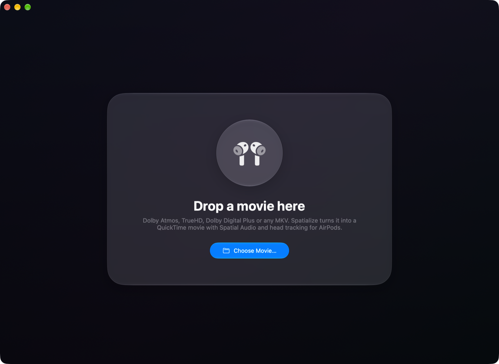
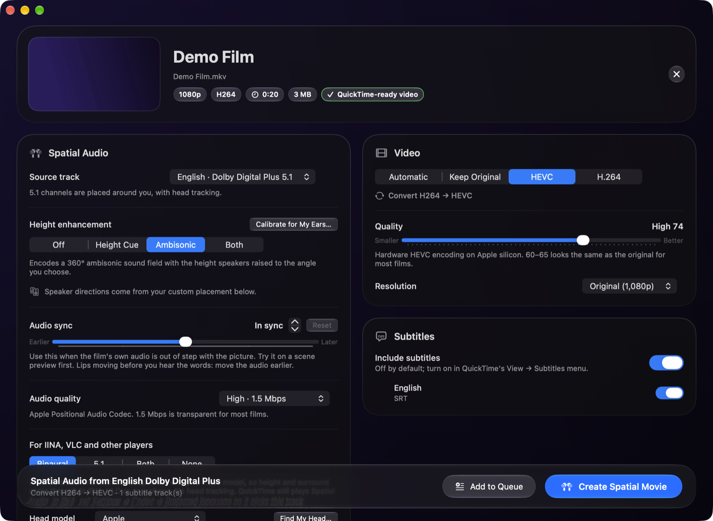
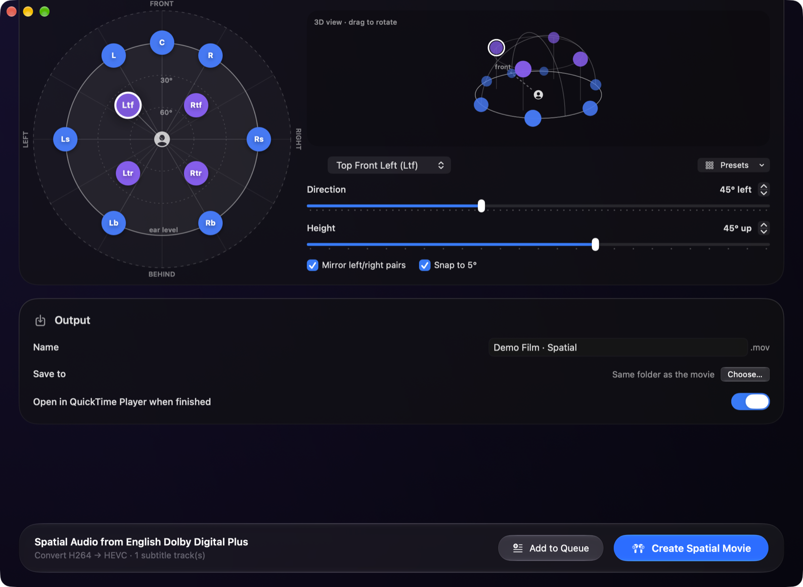
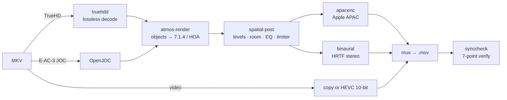

<div align="center">



# Spatialize

### Dolby Atmos movies → Apple Spatial Audio with head tracking on your AirPods.

Drop in an MKV with a TrueHD Atmos or Dolby Digital Plus Atmos track. Spatialize renders every
Atmos object into Apple's own spatial audio codec (APAC) and writes a `.mov` that QuickTime plays
**with head tracking**: turn your head and the helicopter stays where it was.

[**⬇ Download for Mac**](https://github.com/akbehera5000/spatialize/releases/latest) ·
[**Try the 3D sound demo in your browser**](https://akbehera5000.github.io/spatialize/) ·
[How it works](#how-it-works)


</div>

---

## Why

Apple's Spatial Audio with head tracking is magic, but on a Mac it only works with content Apple
or a streaming service has already mastered. Your Blu-ray Atmos rips play as plain stereo.
Spatialize closes that gap. There is no cloud and no account: everything runs on your Mac.

<p align="center"></p>

## Features

| | |
|---|---|
| 🎧 **Real Atmos objects** | TrueHD Atmos (lossless) and E-AC-3 JOC decoded to beds + moving objects, rendered to 7.1.4 or straight into a 360° ambisonic field (*Precise object placement*) |
| 🧭 **Head tracking** | Encoded as APAC, Apple's spatial codec, so QuickTime and AirPods track your head natively |
| ⬆️ **Height you can actually hear** | Overhead-cue EQ, ambisonic speaker raising, and a 2-minute **height calibration** test for your ears |
| 🧑‍🔬 **Find your head** | A listening test compares Apple's head model, KEMAR and 7 measured human heads (SOFA) and picks the one you localise best |
| 🎬 **Plays everywhere** | A **binaural** stereo track (rendered with your head model) for IINA, VLC and phones, plus an optional 5.1 copy |
| 🕹️ **Listen Live** | Hear a scene rendered around your head in real time, with AirPods head tracking and a live map of every object |
| ✅ **Sync verified** | After every conversion the result is compared with the source at 7 points. Offsets are fixed in seconds without reconverting |
| 🌈 **HDR kept** | AV1 / HEVC / Dolby Vision 7 → 10-bit HDR10 HEVC with mastering metadata, or tone-mapped SDR |
| 🔤 **Picture subtitles → text** | Blu-ray PGS subtitles read with Apple Vision OCR |
| 🧰 **Day-to-day** | Queue, scene previews, headphone EQ, dialogue / LFE / night mode / loudness, resume after interruptions, Finder right-click and Shortcuts actions |

<p align="center"></p>

## Install

1. Download **Spatialize.zip** from the [latest release](https://github.com/akbehera5000/spatialize/releases/latest) and unzip it.
2. The app isn't notarized, so the first time **right-click → Open** (or System Settings → Privacy & Security → Open Anyway).
3. Drop a movie on the window.

Needs an Apple silicon Mac with macOS 26 or later. In IINA, set *Settings → Codec → Preferred
language* (e.g. `eng`) so it picks the binaural track.

## How it works



The Mac app is SwiftUI with Liquid Glass; the DSP is Rust (renderer, room, dynamics) and Swift
(APAC encoder, muxer, binaural renderer, sync check, OCR). Each step is a small command-line
tool, so the whole pipeline also works without the app.

## Build from source

```bash
./build.sh          # tools + decoders (installs Rust and ffmpeg with Homebrew if missing)
app/make-app.sh     # → Spatialize.app
```

## The engine: `atmos2apple`

Converts movies with Dolby audio into a `.mov` that macOS plays with **Spatial Audio + head
tracking** on AirPods (QuickTime Player, or any AVFoundation-based player).

```bash
./atmos2apple "Movie.mkv"                 # writes "Movie.spatial.mov" next to it
./atmos2apple "Movie.mkv" out.mov --track 1 --bitrate 2000000
```

| Input audio | What happens |
|---|---|
| TrueHD Atmos (Blu-ray) | lossless decode + Atmos objects via **truehdd** → rendered to 7.1.4 |
| E-AC-3 JOC Atmos (streaming) | objects decoded via **OpenJOC** → rendered to 7.1.4 |
| TrueHD / E-AC-3 / AC-3 / anything else without Atmos | decoded by ffmpeg, placed into 7.1.4 |

The 7.1.4 mix is encoded with Apple's **APAC** codec (default 1.5 Mbps) and tagged with the
Atmos 7.1.4 layout. Video is copied untouched. Subtitles and other audio tracks are dropped.

### Height
Headphone height is weak with Apple's generic head model, so the converter strengthens it:

| `--height` | Output | Effect |
|---|---|---|
| `eq` (default) | 7.1.4 | +6 dB around 7.5 kHz on the top speakers, the band the ear reads as "above" (`--height-eq DB`) |
| `hoa` | 3rd-order ambisonics | sound field with the top speakers raised to 60° (`--height-angle DEG`) |
| `hoa+eq` | 3rd-order ambisonics | both |
| `off` | 7.1.4 | plain |

`height-tests/` has the speaker-walk test in each variant (A–E) to compare by ear.

### More engine options
`--objects direct`, `--dialogue DB`, `--lfe DB`, `--room small|living|cinema[:AMOUNT]`, `--night`,
`--loudness LUFS|off`, `--sync MS`, `--ocr-subs LIST|all`, `--start S --duration D` (scene clip),
`--keep-master DIR`, `--compat binaural|aac|both|none`, `--hrtf apple|FILE.sofa`, `--eq G1,…,G10`,
`--resume on|off`, `--verify on|off`. Re-time a finished movie:
`bin/mux --resync IN.mov --out OUT.mov --delay SECONDS`.

### Pieces
- `tools/atmos-render` – Rust; renders an Atmos master (beds + moving objects) to 7.1.4
- `tools/apacenc.swift` – encodes 7.1.4 audio to APAC
- `tools/mux.swift` – joins video + APAC audio into a `.mov` (ffmpeg can't mux APAC); also re-times
- `tools/atmos-render/src/bin/spatial-post.rs` – mix stage: levels, room, dynamics, height, ambisonics
- `tools/binaural/main.swift` – 7.1.4 → binaural stereo with a head model (`app/…/HRIRSet.swift`)
- `tools/pgs2srt.swift` – PGS picture subtitles → SRT with Vision OCR
- `vendor/libmysofa` – SOFA HRTF reader (BSD-3-Clause), compiled into the app
- `vendor/` – truehdd and OpenJOC sources; `./build.sh` rebuilds everything

### Check your AirPods
Play `spatial-test.mov`: pink noise walks around all 11 speakers, and the screen names each
one. With Spatial Audio on (Control Center → Sound → AirPods → Spatial Audio: Head Tracked), the
"Top…" ones should sound above you and stay put when you turn your head.

### Limits
- Temp files for a TrueHD movie can be tens of GB, on the same disk as the output.
- QuickTime must be able to play the video codec (H.264/HEVC fine; AV1 needs M3 or later;
  VC-1/MPEG-2 won't play). Dolby Vision profile 7 (dual-layer Blu-ray) may not play.
- Decoders are third-party clean-room implementations, not Dolby's own; for personal use.


## Credits and legal

Built on [truehdd](https://github.com/truehdd/truehdd), [OpenJOC](https://github.com/chyinan/OpenJOC),
[libmysofa](https://github.com/hoene/libmysofa) and [FFmpeg](https://ffmpeg.org). See
[THIRD_PARTY_NOTICES.md](THIRD_PARTY_NOTICES.md). Spatialize is an independent project, not
affiliated with Dolby Laboratories or Apple; "Dolby Atmos", "AirPods" and "Spatial Audio" are
their trademarks. The decoders are clean-room implementations. Use it with media you own.

If Spatialize made your movies sound better, a ⭐ helps others find it.
